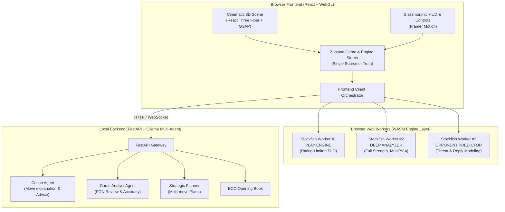
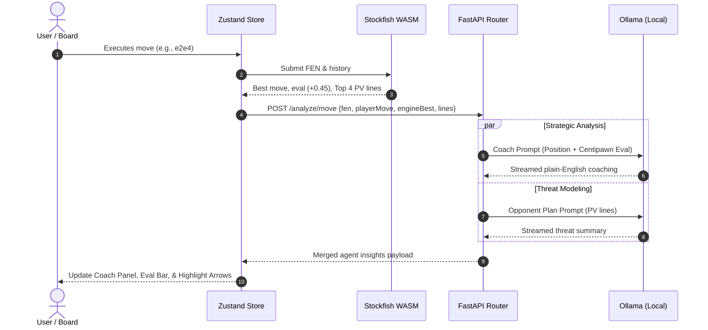

# ♟️ OmniChess AI — Complete Architecture & Technical Documentation

> **A high-performance cinematic 3D chess workstation and multi-agent AI coaching platform powered by Stockfish WASM and local LLMs (Ollama) — engineered to run 100% locally and free.**

---

## 📑 Table of Contents
1. [Overview & Vision](#-overview--vision)
2. [High-Level Architecture](#-high-level-architecture)
3. [The Dual-Brain Paradigm](#-the-dual-brain-paradigm)
4. [Engine Layer — Stockfish Multi-Worker System](#-engine-layer--stockfish-multi-worker-system)
   - [Isolated Web Workers](#isolated-web-workers)
   - [UCI Protocol Integration](#uci-protocol-integration)
   - [ELO Mapping & Human-like Play](#elo-mapping--human-like-play)
   - [Centipawn Loss & Move Classification](#centipawn-loss--move-classification)
5. [Cinematic 3D Graphics & Visual System](#-cinematic-3d-graphics--visual-system)
   - [Three.js & React Three Fiber Pipeline](#threejs--react-three-fiber-pipeline)
   - [Procedural PBR Geometries](#procedural-pbr-geometries)
   - [Dynamic Lighting & Cinematic Camera](#dynamic-lighting--cinematic-camera)
   - [Post-Processing Stack](#post-processing-stack)
   - [Particle Systems & Theme Engine](#particle-systems--theme-engine)
6. [Multi-Agent AI Coaching Architecture](#-multi-agent-ai-coaching-architecture)
   - [Agent Roles & Responsibilities](#agent-roles--responsibilities)
   - [Orchestration Sequence Flow](#orchestration-sequence-flow)
   - [Local LLM Configuration (Ollama)](#local-llm-configuration-ollama)
7. [Repository File Map](#-repository-file-map)
8. [Roadmap & Sprint Execution](#-roadmap--sprint-execution)
9. [Tech Stack & Decision Matrix](#-tech-stack--decision-matrix)
10. [Local Development & Setup](#-local-development--setup)

---

## 🌟 Overview & Vision

OmniChess AI transitions classical digital chess away from static 2D grid boards into a **cinematic 3D workstation** paired with **grandmaster-grade AI capabilities**. 

Traditional chess applications often suffer from two extremes:
1. Pure calculation engines (e.g. standard UCI interfaces) that offer raw centipawn evaluations and PV lines without clear, natural human explanations.
2. Naive LLM chatbots that attempt to play chess directly, inevitably hallucinating moves, generating illegal positions, and miscalculating depths.

**OmniChess AI synthesizes both domains:**
- **Stockfish WASM (NNUE)** handles strict, deterministic move calculation, evaluation, MultiPV lines, and opponent threat modeling.
- **Specialized Local AI Agents (Ollama)** translate complex engine matrices into deep strategic concepts, opening advice, tactical refutations, and personalized training insights.
- **React Three Fiber (WebGL) & GSAP** provide an immersive, tactile 3D environment with smooth piece arcs, dynamic lighting, bloom, and responsive glassmorphism HUD overlays.

---

## 🏛️ High-Level Architecture

The system is decoupled into three primary execution tiers:



---

## 🧠 The Dual-Brain Paradigm

| Concern | Primary Engine | Role & Rationale |
|---------|---------------|------------------|
| **"What is the best move?"** | **Stockfish WASM** | Deterministic, mathematically optimal, NNUE evaluation, ELO scalable. |
| **"Why is this move best?"** | **Ollama LLM** (Qwen 2.5 / Llama 3.3) | Semantic translation of engine lines into positional and tactical concepts. |
| **"What is opponent threatening?"** | **Stockfish WASM** (Flipped Perspective) | Computes opponent counter-replies and mating threats without hallucination. |
| **"How can I improve my play?"** | **Ollama LLM** + Statistical Loss | Pattern recognition across blunder history, pawn structure tendencies. |
| **"Rate my move quality"** | **Stockfish (Delta Eval) → Classifier** | Centipawn loss computation mathematically tagged into standard classifications. |

---

## ⚡ Engine Layer — Stockfish Multi-Worker System

### Isolated Web Workers
To guarantee that intensive chess computations never drop rendering frames in the 60fps/120fps 3D WebGL scene, all Stockfish calculations execute within isolated Web Workers (`src/engine/`):

1. **Play Engine Worker (`play.worker.ts`)**:
   - Executes AI opponent turns.
   - Constrained by `UCI_LimitStrength` and target ELO settings.
2. **Deep Analysis Worker (`analysis.worker.ts`)**:
   - Continuous background calculation at maximum strength (`Skill Level = 20`, Depth 22+).
   - MultiPV mode evaluates top 4 candidate moves simultaneously.
3. **Opponent Predictor Worker (`opponent.worker.ts`)**:
   - Evaluates the position from the opposing perspective to calculate immediate threats and defensive demands.

### UCI Protocol Integration
`UCIProtocol.ts` provides a structured, type-safe messaging bridge over raw UCI strings:
- Manages `uci`, `isready`, `ucinewgame`, `position fen`, and `go` commands.
- Streams live depth, selective depth, nodes per second (NPS), evaluation centipawns, mate scores, and principal variation (PV) lines directly into Zustand state.

### ELO Mapping & Human-like Play
Stockfish's native `UCI_Elo` engine floor sits around ~1320. To provide realistic gameplay for beginners and club players, `EloMapper.ts` integrates a weighted heuristic randomization layer:

| User Target ELO | UCI Configuration | Heuristic Layer Behavior |
|-----------------|-------------------|--------------------------|
| **800 ELO** | `Skill Level = 0` (1320) | 55% probability of selecting alternative legal/sub-optimal moves |
| **1000 ELO** | `Skill Level = 0` (1320) | 30% probability of selecting alternative moves |
| **1200 ELO** | `UCI_LimitStrength`, `Elo = 1320` | 10% sub-optimal move selection |
| **1400 ELO** | `UCI_LimitStrength`, `Elo = 1444` | Pure Stockfish rating-limited play |
| **1600 ELO** | `UCI_LimitStrength`, `Elo = 1566` | Pure Stockfish rating-limited play |
| **1800 ELO** | `UCI_LimitStrength`, `Elo = 1729` | Pure Stockfish rating-limited play |
| **2000 ELO** | `UCI_LimitStrength`, `Elo = 1953` | Pure Stockfish rating-limited play |
| **2200 ELO** | `UCI_LimitStrength`, `Elo = 2197` | Pure Stockfish rating-limited play |
| **2400 ELO** | `UCI_LimitStrength`, `Elo = 2518` | Master strength |
| **2500+ (GM)** | `Skill Level = 20` | Full neural network calculation (~3650+ ELO) |

### Centipawn Loss & Move Classification
Every move is evaluated against the position's top engine line using `MoveClassifier.ts`:

| Centipawn Loss (Δcp) | Classification | Visual / UI Feedback |
|----------------------|----------------|----------------------|
| **0 cp (Unique Best)** | 💎 **Brilliant** | Cyan/Diamond glow, sparkle particle burst |
| **0 cp (Top Line)** | 🟢 **Best** | Green badge, clean audio chime |
| **0 – 20 cp** | ✅ **Great** | Green check indicator |
| **20 – 50 cp** | 🔵 **Good** | Blue status badge |
| **50 – 100 cp** | 🟡 **Inaccuracy** | Amber warning indicator |
| **100 – 300 cp** | 🟠 **Mistake** | Orange alert, coach tactical tip |
| **300+ cp** | 🔴 **Blunder** | Red camera pulse, refutation display |

---

## 🎬 Cinematic 3D Graphics & Visual System

### Three.js & React Three Fiber Pipeline
The 3D environment is rendered via `@react-three/fiber` and `@react-three/drei`, leveraging WebGL hardware acceleration:
- **Procedural Geometries (`PieceFactory.ts`)**: Lathe and compound geometries for all standard Staunton pieces (Pawns, Rooks, Knights, Bishops, Queens, Kings) generated on runtime — eliminating external asset load latencies and network failures.
- **PBR Shading**: Physically Based Rendering materials with customizable roughness, metalness, clearcoat, and environmental reflection maps.

### Dynamic Lighting & Cinematic Camera
- **Lighting Rig (`Lighting.tsx`)**: Warm key directional light with soft shadow mapping, cool cyan rim lighting for piece separation, and dynamic spotlights tracking hovered and selected squares.
- **Cinematic Orbit Camera (`CameraController.tsx`)**:
  - *Default (3/4 Isometric Perspective)*: `[0, 12, 10]`
  - *White POV*: `[0, 8, 14]`
  - *Black POV*: `[0, 8, -14]`
  - *Tactical Overhead 2D-in-3D*: `[0, 20, 0]`
  - Smooth camera swoops driven by GSAP power-eased interpolation curves.

### Post-Processing Stack (`PostProcessing.tsx`)
Configurable post-processing shaders via `@react-three/postprocessing`:
- **Unreal Bloom**: Subtle emissive glow on metallic edges and highlight squares.
- **SSAO (Screen Space Ambient Occlusion)**: Realistic contact shadows grounding pieces on the board.
- **Vignette & Chromatic Aberration**: Subtle edge darkening for cinematic lens framing.

### Particle Systems & Theme Engine
- Living particle background (`Particles.tsx`) generating subtle drifting motes, star dust, or mist based on the active theme.
- **Theme presets**:
  - *Obsidian Night*: Dark marble, gold inlays, cyan accents, space nebula atmosphere.
  - *Royal Classic*: Rich walnut, ivory, warm chandelier lighting, castle ambient tones.
  - *Neon Cyber*: High-contrast glass, luminescent grid lines, purple/cyan neon.
  - *Minimalist White*: Studio lighting, matte white & charcoal pieces.
  - *Tournament Green*: Regulation green felt, Staunton matte aesthetics.

---

## 🤖 Multi-Agent AI Coaching Architecture

### Agent Roles & Responsibilities

The local Python FastAPI service (`backend/`) orchestrates specialized agent prompts interacting with Ollama:

```
backend/
├── main.py                    # FastAPI entrypoint & WebSocket handlers
├── agents/
│   ├── orchestrator.py        # Dispatcher & context aggregator
│   ├── coach_agent.py         # Real-time move explanations & hints
│   ├── game_analyst.py        # Post-game comprehensive report
│   ├── strategic_planner.py   # Multi-move strategic themes & pawn structure
│   ├── opponent_profiler.py   # Predicts threats and opponent psychology
│   └── weakness_detector.py   # Analyzes recurring centipawn drop patterns
└── services/
    ├── ollama_client.py       # Asynchronous streaming client for Ollama
    ├── opening_book.py        # ECO lookup & opening theory
    └── game_database.py       # Local SQLite persistence
```

### Orchestration Sequence Flow



### Local LLM Configuration (Ollama)
The multi-agent system runs completely private and offline using Ollama:
- **Recommended for 8GB RAM Apple Silicon**: `qwen2.5:7b` (exceptional structured reasoning and chess token efficiency).
- **Recommended for 16GB+ RAM**: `llama3.3:70b` or `llama3.3:8b`.
- **Reasoning Variant**: `deepseek-r1:8b`.

---

## 🗂️ Repository File Map

```
My-Chess-Tech/
├── index.html                     # Application HTML entry point
├── package.json                   # Dependencies (Three.js, R3F, Stockfish, Lucide, Zustand)
├── vite.config.ts                 # Vite config (COOP/COEP enabled for WASM threads)
├── tsconfig.json                  # Strict TypeScript configuration
├── public/
│   ├── stockfish.js               # Stockfish WASM binary & loader
│   ├── stockfish.wasm
│   └── textures/                  # PBR texture maps
│
├── src/
│   ├── main.tsx                   # React root mount
│   ├── App.tsx                    # Main 3D Canvas + Glassmorphism HUD layout
│   ├── index.css                  # Design tokens, CSS variables, typography
│   │
│   ├── engine/                    # ♟️ Stockfish WASM Engine Layer
│   │   ├── StockfishManager.ts    # Singleton orchestrator for 3 worker instances
│   │   ├── UCIProtocol.ts         # Type-safe UCI parser & command dispatcher
│   │   ├── EloMapper.ts           # Rating to UCI parameter & randomization mapping
│   │   └── MoveClassifier.ts      # Centipawn loss delta evaluator
│   │
│   ├── scene/                     # 🎬 3D WebGL Scene (React Three Fiber)
│   │   ├── ChessScene.tsx         # Canvas root, camera setup, scene layout
│   │   ├── Board3D.tsx            # Procedural 3D board geometry & square interaction
│   │   ├── Piece3D.tsx            # Individual 3D piece with hover/select animations
│   │   ├── PieceFactory.ts        # Procedural piece geometry generator
│   │   ├── Lighting.tsx           # Key, rim, and dynamic square spotlights
│   │   ├── CameraController.tsx   # Cinematic camera transitions with GSAP
│   │   ├── Particles.tsx          # Dynamic atmospheric background particles
│   │   ├── MoveAnimator.ts        # Piece arc & movement interpolator
│   │   └── PostProcessing.tsx     # Bloom, SSAO, and vignette shader effects
│   │
│   ├── components/                # 🖥️ HUD Overlay & Glassmorphic UI
│   │   ├── Board/
│   │   │   └── BoardOverlay.tsx   # Coordinate notations & dynamic 2D overlays
│   │   ├── Coach/
│   │   │   └── CoachPanel.tsx     # Stockfish-informed AI coach panel
│   │   ├── Game/
│   │   │   ├── GameControls.tsx   # Game modes, turn indicators, actions
│   │   │   └── RatingSlider.tsx   # ELO strength controller
│   │   └── HUD/
│   │       ├── AnalysisTabs.tsx   # Best moves, opponent plan, test ideas
│   │       ├── EvalBar.tsx        # Dynamic centipawn advantage bar
│   │       └── MoveHistory.tsx    # Scrollable move ledger with classifications
│   │
│   ├── store/                     # 📦 Reactive State Management (Zustand)
│   │   ├── gameStore.ts           # Game rules, board state, move dispatcher
│   │   ├── engineStore.ts         # Live engine evaluation, lines, worker states
│   │   └── themeStore.ts          # Visual themes, camera presets, audio settings
│   │
│   └── audio/                     # 🔊 Audio Engine
│       └── soundEngine.ts         # Move, capture, check, and victory sound synthesis
│
└── backend/                       # 🐍 Local AI Multi-Agent Service (FastAPI)
    ├── main.py                    # API Gateway & WebSocket endpoints
    ├── requirements.txt           # Python dependencies (FastAPI, uvicorn, pydantic)
    └── agents/                    # Specialized agent modules
```

---

## 📋 Roadmap & Sprint Execution

- [x] **Sprint 1: Engine Foundation**
  - Integrate Stockfish WASM multi-worker architecture (`StockfishManager.ts`).
  - Implement full UCI protocol streaming parser (`UCIProtocol.ts`).
  - Wire ELO mapping (800–2500+ GM) with human-like randomization (`EloMapper.ts`).
  - Centipawn-based move classification (Brilliant, Best, Inaccuracy, Mistake, Blunder).
- [x] **Sprint 2: Cinematic 3D Scene**
  - High-performance WebGL Canvas with React Three Fiber.
  - Procedural Staunton piece geometries with PBR materials (`PieceFactory.ts`).
  - Smooth camera choreography and perspective presets (`CameraController.tsx`).
  - Post-processing pipeline (Unreal Bloom, SSAO, Vignette).
  - Living atmospheric particle systems.
- [x] **Sprint 3: Glassmorphism HUD & Interface Polish**
  - Interactive analysis tabs: *Best Move*, *Opponent Plan*, *Test Ideas*, *Move History*.
  - Vertical real-time evaluation bar.
  - ELO rating selector slider and mode switcher (Vs AI, Local, Analysis, Training).
  - Dark glassmorphism HUD with responsive pointer-events overlay.
- [ ] **Sprint 4: Multi-Agent Local LLM Service (FastAPI + Ollama)**
  - Local Ollama agent integration for real-time natural language coaching.
  - Strategic Planner and Opponent Threat profiler prompts.
  - WebSocket streaming coaching dialogue.
- [ ] **Sprint 5: Deep Analytics & Persistence**
  - Post-game review dashboard with accuracy score and skill radar charts.
  - Local SQLite game database for historical win-rates and opening repertoire analytics.

---

## 🔧 Tech Stack & Decision Matrix

| Dimension | Chosen Solution | Rationale vs Alternatives |
|-----------|-----------------|---------------------------|
| **Chess Engine** | **Stockfish WASM (NNUE)** | ~3650 ELO, runs in browser via WebAssembly, zero external API costs or latency. *Rejected: Fake heuristic evaluators (inaccurate) & cloud engine APIs (latency/cost).* |
| **3D Rendering** | **React Three Fiber (Three.js)** | Declarative React integration, GPU-accelerated WebGL, rich ecosystem. *Rejected: Plain Three.js (imperative state friction) & Unity/Unreal (heavyweight, non-web-native).* |
| **Motion & Camera** | **GSAP & Framer Motion** | Industry standard for smooth bezier animation curves and UI micro-interactions. |
| **State Management** | **Zustand** | Minimal boilerplate, blazing fast outside React render cycles, optimal for streaming engine outputs. |
| **AI LLM Coaching** | **Ollama (Local)** | 100% offline, privacy-first, zero API tokens, optimized for Apple Silicon metal acceleration. *Rejected: Cloud APIs (recurring costs, privacy leaks, offline unavailability).* |
| **Backend Layer** | **FastAPI (Python)** | Native async streaming, low overhead, seamless integration with AI and local data pipelines. |

---

## 🚀 Local Development & Setup

### Prerequisites
- **Node.js**: v18.0+
- **Python**: 3.10+ (for optional multi-agent backend)
- **Ollama** (optional for local LLM coach): [ollama.com](https://ollama.com)

### 1. Frontend Setup
```bash
# Clone the repository
git clone https://github.com/A-L-RAHUL/my-chess-Coach.git
cd my-chess-Coach

# Switch to the v1 branch
git checkout v1

# Install dependencies
npm install

# Start the Vite development server
npm run dev
```
Open [http://localhost:5173](http://localhost:5173) in your browser.

### 2. Backend Setup (Optional — Multi-Agent Coach)
```bash
cd backend

# Create virtual environment
python3 -m venv venv
source venv/bin/activate

# Install backend dependencies
pip install -r requirements.txt

# Start the FastAPI service
python main.py
```

### 3. Local LLM Setup (Optional)
```bash
# Start Ollama service
ollama serve

# Pull recommended model
ollama pull qwen2.5:7b
# or for 16GB+ RAM:
ollama pull llama3.3
```

---

## 📄 License
This project is open-source under the [MIT License](LICENSE).
Stockfish WASM is distributed under the GNU General Public License v3 (GPL-3.0).
